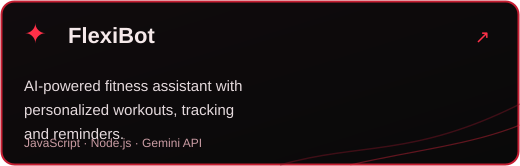
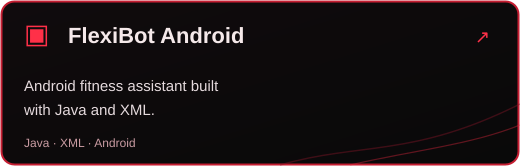
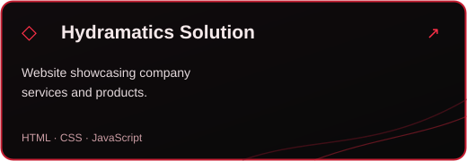
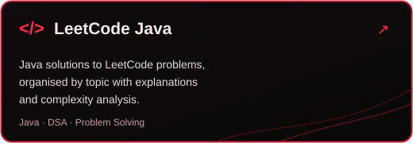

<!-- NAMITHAR30 | black + crimson profile -->

**INFORMATION SCIENCE ENGINEERING STUDENT &nbsp;·&nbsp; ASPIRING SOFTWARE DEVELOPER**

Building practical applications, exploring AI, and improving through consistent problem-solving.

##  ABOUT ME

- Information Science Engineering student at New Horizon College of Engineering
- Interested in software development, Android development, and AI-powered applications
- Building **FlexiBot**, an AI-assisted fitness application
- Practising data structures and algorithms with Java
- Continuously learning by building and improving projects

##  TECH STACK

##  FEATURED PROJECTS

##  GITHUB STREAK

##  LEETCODE

<a href="https://leetcode.com/u/namitharavi/">Open LeetCode profile ↗</a> · Snapshot dated 15 Nov 2026

##  GITHUB ACTIVITY — LAST 30 DAYS

Automatically refreshed daily · 30-day view

---

Thanks for visiting. Feel free to explore my work.

