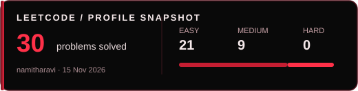

<!-- NAMITHAR30 | black + crimson profile -->

**INFORMATION SCIENCE ENGINEERING STUDENT &nbsp;·&nbsp; ASPIRING SOFTWARE DEVELOPER**

Building practical applications, exploring AI, and improving through consistent problem-solving.

##  ABOUT ME

- Information Science Engineering student at New Horizon College of Engineering
- Interested in software development, Android development, and AI-powered applications
- Building **FlexiBot**, an AI-assisted fitness application
- Practising data structures and algorithms with Java
- Continuously learning by building and improving projects

##  TECH STACK

##  FEATURED PROJECTS

<table>
<tr>
<td width="50%">
<h3>⌁ FlexiBot</h3>
AI-powered fitness assistant with personalized workouts, tracking and reminders.

JavaScript · Node.js · Gemini API 
<a href="https://github.com/NamithaR30/FlexiBot">Explore project ↗</a>
</td>
<td width="50%">
<h3>▣ FlexiBot Android</h3>
Android fitness assistant built with Java and XML.

Java · XML · Android 
<a href="https://github.com/NamithaR30/FlexiBot-Android">Explore project ↗</a>
</td>
</tr>
<tr>
<td width="50%">
<h3>◇ Hydramatics Solution</h3>
Website showcasing company services and products.

HTML · CSS · JavaScript 
<a href="https://github.com/NamithaR30/hydramatics-solution">Explore project ↗</a>
</td>
<td width="50%">
<h3>&lt;/&gt; LeetCode Java</h3>
Java solutions to LeetCode problems, organised by topic with explanations and complexity analysis.

Java · DSA · Problem Solving 
<a href="https://github.com/NamithaR30/LeetCode-Java">Explore project ↗</a>
</td>
</tr>
</table>

##  GITHUB STREAK

##  LEETCODE

<a href="https://leetcode.com/u/namitharavi/">Open LeetCode profile ↗</a> · Snapshot dated 15 Nov 2026

##  GITHUB ACTIVITY — LAST 30 DAYS

Automatically refreshed daily · 30-day view

---

Thanks for visiting. Feel free to explore my work.

