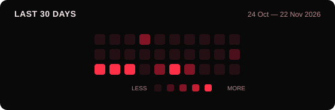

<!--
  NAMITHAR30 — GitHub profile README
  Theme: charcoal + muted steel blue
-->

# Namitha R

**Information Science Engineering Student · Aspiring Software Developer**

Building practical applications, exploring AI, and getting better at problem-solving one commit at a time.

[GitHub](https://github.com/NamithaR30) · [LeetCode](https://leetcode.com/u/namitharavi/)

---

## About me

- 🎓 Information Science Engineering student at New Horizon College of Engineering
- 💻 Interested in software development, Android development, and AI-powered applications
- 🤖 Building **FlexiBot**, an AI-assisted fitness application
- 🧩 Practising data structures and algorithms with Java
- 🌱 Continuously learning by building and improving projects

## Tech stack

## Featured projects

| Project | What it is |
|---|---|
| [FlexiBot](https://github.com/NamithaR30/FlexiBot) | AI-powered fitness assistant project |
| [FlexiBot Android](https://github.com/NamithaR30/FlexiBot-Android) | Android fitness assistant built with Java and XML |
| [LeetCode Java](https://github.com/NamithaR30/LeetCode-Java) | DSA and LeetCode practice solutions in Java |
| [Hydramatics Solution](https://github.com/NamithaR30/hydramatics-solution) | Website project showcasing company services and products |

## GitHub overview

 

## Last 30 days

A compact contribution calendar showing the most recent 30 days. The chart refreshes automatically each day.

## LeetCode

[View my LeetCode profile](https://leetcode.com/u/namitharavi/)

---

*Thanks for stopping by — feel free to explore my repositories.*

